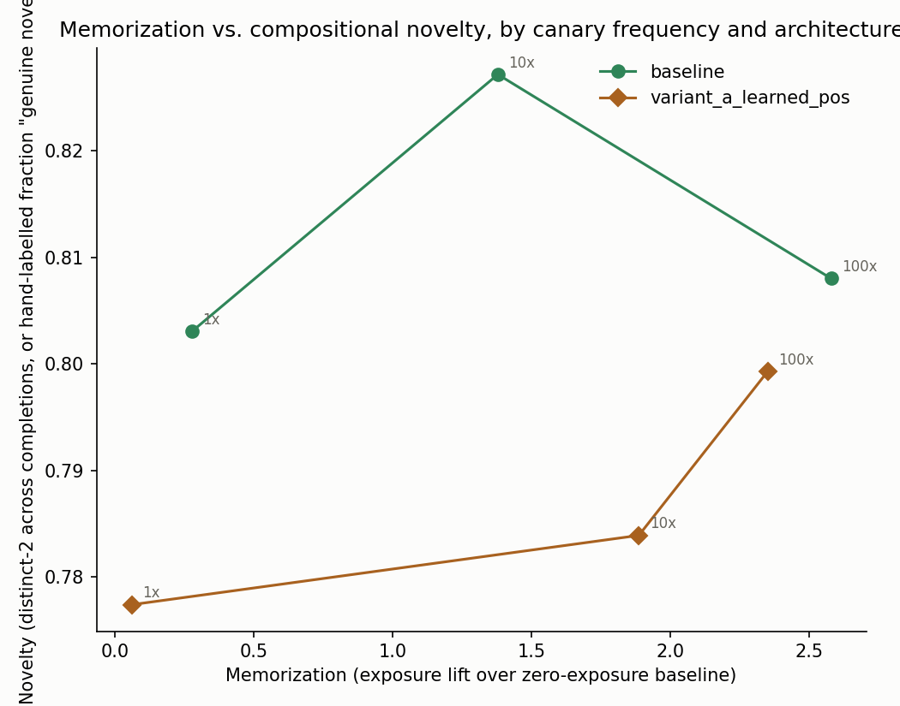
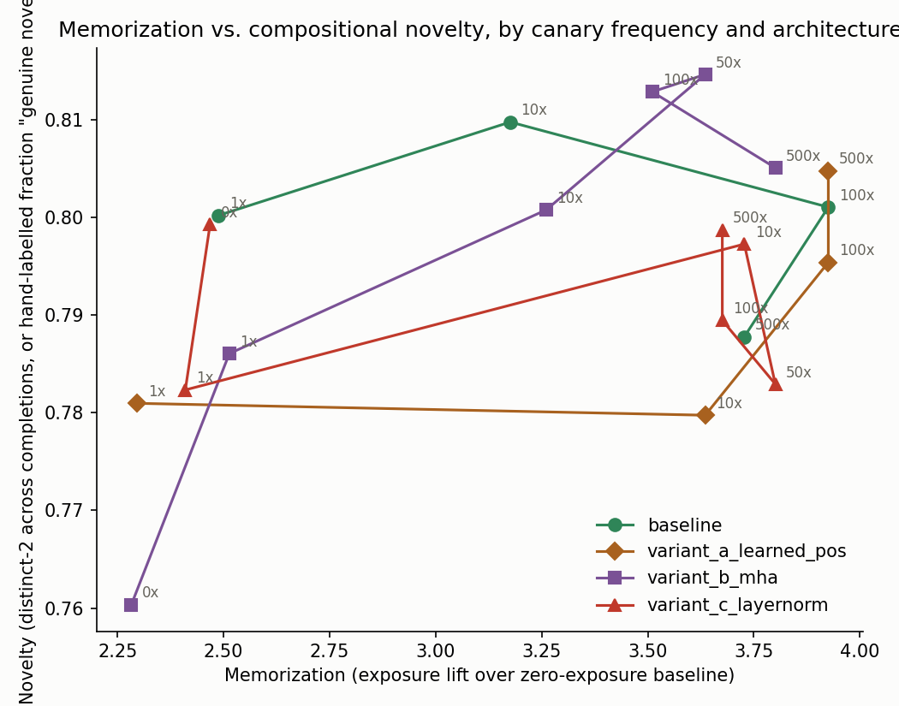

# Memorization vs. compositional creativity in a small language model: does the trade-off depend on architecture?

**Status: exploratory draft, not submission-ready.** The balanced 14M grid, baseline 100/500 training-seed
replications, and all 24 48M scale-transfer cells are complete. Exact full-corpus overlap covers 24 canonical 14M
cells (7,680 completions), two baseline training-seed replications (640 completions), and 24 48M cells (7,680
completions): 50 cells / 16,000 generations total. Independent integrity checks loaded all 106 retained best/final
checkpoints, parsed 175 result JSONs, and verified all 50 overlap reports against their matching frequency-specific
corpus hashes and 73,139-story counts. Matched-baseline tradeoff tables and clean-canary tables/plots have been
regenerated. The initial 48M baseline frequency-0 cell required recovery from a disk-full checkpoint-write failure;
it resumed from a valid step-1,000 checkpoint and completed. The human primary novelty endpoint and the separate
contamination-free confirmatory study remain incomplete; the scale arm is single-seed and exploratory.
The current submission gate is
`docs/PUBLICATION_READINESS.md`.

## Abstract (provisional; do not submit before the human and confirmatory gates)

We study controlled repetition of narrative canaries in from-scratch language models, asking whether exposure and
architecture are associated with memorization and automated novelty proxies. The primary 14M-parameter experiment
crosses four near-matched architectures with six corpus conditions (0, 1, 10, 50, 100, and 500 insertions), with
6,000 updates and a fixed token budget per cell. A separate 24-cell 48M scale-transfer grid uses the same
evaluation families but is single-seed and uses a different learning rate. Corpus inspection found that three of
eight inserted canary identities already occurred in the base corpus, so clean-canary analyses are reported
alongside all-canary results. Across the completed automated grid, exposure and distinct-2 summaries vary by
frequency and architecture, while the distinct-2 proxy does not show a consistent monotonic decline with exposure.
Teacher-forced extraction remains zero in the audited 14M comparisons despite some high exposure rankings. Exact
word-four-gram overlap was evaluated against each matching frequency-specific training corpus for 50 cells and
16,000 generations, including seed controls. These are descriptive results: the factorial cells are mostly
single-seed, automated diversity and overlap are not human creativity judgments, and the 48M arm is not a causal
size comparison. The blinded two-rater V/T/N endpoint has been prepared but not scored, and a separate
contamination-free confirmatory experiment has not been run. Accordingly, this study does not establish a
memorization-versus-creativity trade-off.

## 1. Research question

Does a small (14.2M-parameter) decoder-only transformer, trained on a TinyStories-style corpus, trade off
memorizing recurring narrative elements (character names, plot fragments) against the ability to recombine those
elements into novel stories as exposure frequency increases — and does that trade-off differ by architecture
(positional encoding, attention type, normalization)? (Verbatim research question, `PLAN.md`.)

This project asks whether controlled repetition of narrative elements is associated with automated memorization
and human-rated recombination in a small model. The creativity-capacity trade-off is the motivating hypothesis,
not an established finding. Prior work on memorization, novelty, and composition overlaps this framing; the
defensible contribution and its limits are audited in `docs/RESULTS_CLAIM_AUDIT.md`.

### 1.1 Hypotheses

- **H1 (primary):** Memorization and compositional novelty are not independent. Beyond some exposure threshold,
  increasing repetition of a narrative element reduces the model's tendency to recombine it in new ways — it
  shifts from *composing* to *reproducing*.
- **H2 (secondary):** The location/shape of this trade-off curve depends on architecture. Models with different
  capacity for long-range structure (RoPE vs. learned position encoding; GQA vs. MHA) may resist
  memorization-driven crowding-out differently.

H2 coming back null is still a valid, publishable result: it would mean the trade-off is a function of
data/exposure rather than architecture at this scale — itself informative, and framable as a boundary condition
against the small-model architecture-ablation literature (§2).

**Current hypothesis status.** The completed automated grid is exploratory and mostly single-seed. Clean-canary
exposure-lift means generally rise between low and high frequency in several architecture cells, with plateaus or
reversals in some cells; the two baseline training seeds at frequencies 1, 10, 100, and 500 show appreciable
canary-level differences. Those observations are descriptive, not a calibrated estimate of a population dose-response
or a universal seed-noise threshold. Distinct-2 and overlap are proxies, not judgments of recombination, and their
descriptive summaries do not establish either a novelty cost or its absence. Thus H1's trade-off component and H2
remain unresolved pending human labels and a separately designed, adequately powered confirmation. The 48M grid
adds completed exploratory cells but is single-seed and differs in learning rate; it is not evidence of a causal
scale effect. See `docs/RESULTS_CLAIM_AUDIT.md` for the claim-by-claim evidence boundary.

## 2. Related work

The memorization side of this design follows the "Secret Sharer" methodology of Carlini, Liu, Erlingsson, Kos &
Song (2019), *The Secret Sharer: Evaluating and Testing Unintended Memorization in Neural Networks* — planting
low-frequency "canary" sequences during training and measuring how much more likely the model finds the true
canary than a set of plausible alternatives, via an **exposure** metric (defined in §3.4). This project adapts
that methodology to narrative canaries in a story-generation setting (rather than the original's random
sequences) and pairs it with a compositional-novelty measurement, to ask not just "does it memorize?" but "does
memorizing trade off against creative recombination?"

| Prior work | What it does | Gap this project fills |
|---|---|---|
| Carlini et al. (2019, "Secret Sharer"), Carlini et al. (2020, extraction) | Canary insertion, exposure metric, model-size vs. memorization | Uses generic/random canaries, not structured narrative elements; treats memorization only as a privacy risk |
| Tirumala et al., Carlini et al. (2022/2023) | Memorization scales with model size | Varies *size*, not *architecture at fixed size* (this project's axis) |
| McCoy et al. (2023), RAVEN | Measures n-gram and syntactic novelty in generated text, supported by manual analysis | Provides a stronger novelty-evaluation precedent; this project adds controlled narrative-canary exposure and architecture ablations |
| Haviv et al. (2023), idiom recall | Studies what transformers learn and recall from idiomatic expressions | Closely connects memorized multiword form with compositional behavior, but does not manipulate story-canary frequency across matched architectures |
| Jiang & Ferraro (2026), stories under memorization constraints | Uses stories as a testbed for reasoning under memorization constraints | Makes story-based memorization/novelty no longer unique; this project instead emphasizes controlled exposure manipulation, small models, and fixed-size architecture comparisons |
| Zhou et al. (2026), long-tail memorization and composition | Shows memorizing long-tail data can aid generalization through composition | Directly challenges a one-directional “memorization crowds out composition” premise and motivates testing either sign rather than assuming harm |
| "What Language Model to Train if You Have One Million GPU Hours?"; Wiola-13M architecture ablations | Architecture ablations (position encoding, attention, norm) at small scale | Measures perplexity/capability, not memorization behavior |
| Memory Dial; Memorization Sinks | Controllable/removable memorization | Focused on mitigation, not the creativity trade-off itself |
| TinyStories (Eldan & Li, 2023) | Coherence/fluency of small story-generating models | Does not touch memorization or originality measurement |

The defensible positioning is therefore narrower than the original draft claimed. Prior work already studies
novelty, idiom recall, story-based memorization constraints, and beneficial composition from memorized long-tail
data. This project's potential contribution is the combination of a controlled exposure intervention, transparent
from-scratch small-model training, and near-parameter-matched architecture ablations with both corpus-level and
human novelty checks. Whether memorization helps, harms, or is independent of recombination is an empirical
question here, not an assumed direction. Full references must be verified before submission.

## 3. Methods

### 3.1 Base model and architecture variants

All models share `aarav-lm`'s `small` preset: 8 layers, width 384, 6 query / 2 KV heads (grouped-query
attention), RoPE positional encoding, RMSNorm, SwiGLU, ~14.16M parameters, byte-level BPE tokenizer (vocab 4096,
trained on the base corpus's train split only), context length 512. This is the **baseline** architecture.

The study uses four near-parameter-matched architectures:

| Variant | Change | Parameters | vs. baseline |
|---|---|---|---|
| baseline | — | 14,162,304 | — |
| `variant_a_learned_pos` | RoPE → learned absolute positions (`arch: gpt2`); rest unchanged | 14,358,912 | +1.4% (entirely the added position table; the transformer body itself is identical, 12,589,440 parameters either way) |
| `variant_b_mha` | grouped-query attention → multi-head attention; 7 layers to compensate | 13,964,928 | -1.4% |
| `variant_c_layernorm` | RMSNorm → LayerNorm | 14,162,304 | exact match |

All four architectures are trained and scored across 0, 1, 10, 50, 100, and 500. The balanced 14M grid and baseline
high-frequency second-training-seed replications are complete. All 24 48M scale-transfer cells are complete and
have matching evaluation and full-corpus outputs. The scale comparison remains descriptive: it is single-seed and
uses a different learning rate than the 14M runs, so it does not support a causal scale conclusion.

### 3.2 Canary design

Two canary types, planted as an introductory sentence (character) or mid-story clause (plot fragment) in
TinyStories-style template stories:

- **Character** (4 canaries): a fixed name + trait pairing, e.g. `char_pip` = "Pip the fox, who was always
  hungry."
- **Plot fragment** (4 canaries): a fixed structural phrase inserted mid-story, e.g. `plot_key` = "...then found a
  shiny key under the old oak tree."

Each type also has 2 **unseen controls** — canaries with the same structure, never inserted into any training
corpus, used to calibrate what the exposure metric reports for something the model has truly never seen. A
near-duplicate paraphrase of every inserted canary is pre-registered for future novelty-adjacent analysis but not
yet used.

Canaries are inserted at controlled frequencies into otherwise-identical corpus variants (one fresh pretraining
run per frequency, not fine-tuning, so memorization can be attributed to a known number of training-time
exposures). Pre-registered frequencies are 1, 10, 50, 100, and 500 insertions in a ~14.6M-token corpus, with a
frequency-0 condition added later as an explicit control. Frequency 50 was initially omitted from the reduced
pass, then restored: MHA, LayerNorm, baseline, and learned-position are complete. This
history is an exploratory-design deviation and must be reported as such. Insertion pools are nested (the 10x pool's insertions
are the first 10 of the 100x pool, etc.) for dose-response validity, and disjoint across canaries (one seeded
shuffle, sliced into blocks, so no training story carries two canaries).

All canary bank details are pre-registered in `configs/canaries.yaml` and locked once
`scripts/prepare_canary_corpus.py` has generated the assignment file from it — the assignment cannot silently
drift between runs. The reference-set metadata used for the exposure metric (§3.4) was widened once, after a real
finding (§4.1); this is documented as a metric-implementation fix, not a change to the canary bank itself, and the
original values are kept so all recomputed results stay on one consistent scale.

### 3.3 Training procedure

Each (architecture, frequency) cell is trained from a random initialization (not fine-tuned from a pretrained
checkpoint), on 49.152M training tokens (~3.37 passes over the 14.583M-token training split), 6,000 steps, batch size 1 × grad-accum 16
(effective 16 sequences/step, 512 tokens/sequence), peak LR 8e-4 with 150-step warmup and cosine decay to 10% of
peak, weight decay 0.1, gradient clipping at norm 1.0. Same tokenizer, vocabulary, context length, token budget,
learning-rate schedule and batch size across every architecture and frequency, so architecture is the only
intended axis of variation within a comparison. The main grid uses fixed, logged `train.seed` 20260927. Additional
baseline runs use `train.seed` 1338 while holding `data.seed` (corpus construction and canary insertion) constant
at frequencies 0, 1, 10, 100, and 500. The frequency-0 and frequency-1 pairs are the comparisons used for the
reported ±2.459 observed same-condition exposure swing (§4.2); the other seed outputs are retained separately and
do not make the four-architecture factorial grid multi-seed. `_gen1338` denotes generation-only seed outputs;
`_seed1338` denotes alternate training-seed outputs.

### 3.4 Memorization metric

Following Carlini et al. (2019): for a canary occupying an "identity slot" in a fixed sentence frame (e.g. the
name in "____ the fox, who was always hungry"), build a reference set of *N* plausible alternatives for that slot,
score the true canary's sequence log-probability against every alternative's, and rank the true value among the
*N+1* candidates (rank 1 = model's most-preferred). Exposure is defined as

```
exposure = log2(N + 1) − log2(rank)
```

so exposure is maximal (`log2(N+1)`) when the true canary ranks first, and near zero when it ranks last.

Free greedy extraction is reported separately from exposure. For character canaries, the shared prompt means
these outcomes are not independent per-canary trials; see the metric implementation notes in
`PHASE4_NOTES.md`. The corrected teacher-forced diagnostic is described below and its audited scope is limited to
the architectures and frequencies explicitly reported there.

The corrected teacher-forced diagnostic (`argmax_match`) conditions on the true preceding identity tokens and
checks whether each next-token prediction is the vocabulary argmax. In the audited subset of baseline and
learned-position checkpoints at five nonzero frequencies (120 canary-checkpoint pairs), the recorded
`first_token_match` and `full_match` counts are zero. This is a bounded negative result for that subset and strict
decoding criterion, not a well-powered general finding or evidence that no extraction is possible across other
architectures, seeds, prompts, or decoding rules. Exposure ranks the true canary against a curated reference set;
argmax extraction asks a different and stricter question.

**Reference-set size matters, and was found empirically to matter more than a first pass assumed** (§4.1):
starting sizes were 9 candidates for character canaries (8 alternative names) and 5 for plot fragments (4
alternative substitutions), later widened to 20 and 10 respectively. A canary that would rank first among *any*
plausible alternative by sheer fluency, independent of training exposure, saturates the metric at its ceiling
regardless of reference-set size — this was found empirically for 4 of the 8 inserted canaries (§4.1) and is not
fixable by widening alone.

**Interpretation requires a matched zero-exposure control**, not a raw exposure number: this project trains a
`freq_0` condition (identical recipe, canary bank never inserted) per architecture and reports **lift** (treatment
exposure minus that architecture's own `freq_0` exposure for the same canary) as the primary quantity, not raw
exposure. A architecture-mismatched or under-trained baseline is not a valid substitute (§4.1 explains why one was
initially used, and the fix).

### 3.5 Compositional-novelty metric

Per the brief (`PLAN.md` Phase 5), prompt
the model with a canary's identity placed into one of four pre-registered, deliberately implausible-for-TinyStories
settings (e.g. "a pirate ship sailing a stormy sea"), generate multiple completions at temperature 0.7-1.0, and
measure self-BLEU (diversity across completions of the same prompt), distinct-n, and overlap against training
stories. The original diagnostic compares only the stories selected for canary insertion; it is not evidence of
novelty relative to the whole corpus. `scripts/eval_full_corpus_overlap.py` implements an exact maximum
word-four-gram overlap search against every story in the frequency-specific training corpus, with corpus-hash and
index provenance. It has been run for the 24-cell 14M grid, two baseline seed controls, and 24-cell 48M grid (50
cells / 16,000 completions). This is a copying diagnostic, not a semantic originality test.

The primary endpoint is blinded human classification into verbatim reproduction (V), template copy (T), or
genuine novel recombination (N). `scripts/prepare_blinded_annotations.py` creates balanced condition-hidden files
for two raters; `scripts/score_blinded_annotations.py` reports Cohen's kappa, Krippendorff's alpha, disagreements,
and cluster-bootstrap intervals, and refuses final scoring until disagreements are adjudicated. The complete
locked procedure is in `docs/ANNOTATION_PROTOCOL.md`. Legacy condition-revealing text batches and automated labels
are not admissible evidence.

### 3.6 Statistical approach

- **Lift, not raw exposure**, is the unit of comparison (§3.4), computed against a same-recipe, same-architecture
  `freq_0` control.
- **Training-seed variability**: baseline frequency-0 and frequency-1 paired training-seed runs (§4.2) hold
  corpus construction and canary insertion fixed and change the training run. The largest displayed canary swing
  is ±2.459 exposure units. This is a direct warning about run-to-run sensitivity, not a well-estimated general
  noise distribution: it uses two seeds, one architecture, and a small selected set of canaries. Baseline
  frequency-10/100/500 second-seed outputs are retained separately and are not treated as a replicated factorial
  architecture-by-frequency grid.
- **Cross-architecture replication** is used as a second, independent line of evidence for which canaries show a
  real signal (§4.3): a lift pattern that appears in two different architectures, trained independently, is harder
  to explain as noise than either result alone, without needing multiple seeds of either one.
- The completed automated trade-off tables are descriptive means, not inferential tests; the factorial cells
  mostly have one training seed. After human labels are locked, use the pre-specified per-condition Wilson and
  canary-setting-cluster bootstrap intervals in `docs/ANNOTATION_PROTOCOL.md`. Treat any additional model or
  contrast as exploratory unless registered before labels are revealed.

## 4. Results

### 4.1 Finding: three canaries were never actually novel to the base corpus — a canary-design flaw, not a metric flaw

The first `freq_0` control (baseline architecture) revealed that with the original reference-set sizes (9
candidates for character canaries, 5 for plot fragments), several canaries hit the *maximum possible exposure*
even with **zero training exposure**: `char_pip` and three of four plot-fragment canaries. The reference-set size
was widened (8 → 19 alternatives for character canaries, 4 → 9 for plot fragments; `configs/canaries.yaml`) and
every affected result recomputed on the same, already-trained checkpoints. **The widening only partially resolved
the problem**: `char_pip`, `plot_key`, and `plot_voice` saturated at the new ceiling in the initially scanned
conditions. Their scores remain confounded by pre-existing base-corpus familiarity.

**A relevant confound is directly checkable against the training corpus**: these three selected identities already
occurred substantially in the base corpus, independent of study insertion —

| Canary | Identity phrase | Occurrences in the base corpus | Initial exposure observation |
|---|---|---|---|
| `char_pip` | "Pip" | 150 | Saturated in scanned conditions |
| `plot_key` | "a shiny key" | 41 | Saturated in scanned conditions |
| `plot_voice` | "a soft voice" | 67 | Saturated in scanned conditions |
| remaining five identities | — | 0 exact phrase hits | Exposure patterns vary; no uniform response assumed |

"Pip" is a name TinyStories already uses 150 times; "a shiny key" and "a soft voice" are phrases it already uses
dozens of times. A model may assign these higher probability before any study insertion, so their scores cannot be
attributed solely to controlled repetitions. The other five inserted identities had zero exact phrase hits in the
scanned base corpus; their observed exposure patterns still vary by canary, frequency, and training seed, and
should not be summarized as a universal response. The two unseen-control types (`Olen`, `Teva`) and all reference
alternatives were also checked; this scan is an exact phrase check, not a guarantee against semantic contamination.

**Methodological implication for canary-based memorization studies, general beyond this project**: a canary's
"novelty" needs to be verified against the actual pretraining corpus before it is locked into the design, not
assumed from the name or phrase sounding unusual. This project's own alternative-name pool, checked after the
fact, turned up four more names (`Mira`, `Zeb`, `Dara`, `Nell`) with 12-76 base-corpus occurrences that happened
not to be selected as true canary identities — avoiding the same problem by luck, not by design. **A base-corpus
frequency check on every candidate canary identity and every reference-set alternative should be a required
pre-registration step**, run before Phase 1 is locked, not a diagnostic performed three phases later after a
result looks confusing. It takes seconds to run and would have caught this project's version of the problem
immediately.

### 4.2 Finding: paired baseline runs show seed sensitivity, but do not estimate a general noise distribution

Earlier cross-frequency comparisons showed changes for controls that were never deliberately inserted. Those
comparisons changed the training corpus and therefore cannot isolate training-seed noise; they are exploratory
observations, not a calibrated noise estimate:

| Control | Architecture | Swing observed |
|---|---|---|
| `ctrl_char_teva` | baseline | +0.848 (freq_0 → freq_1), +1.585 (freq_0 → freq_10) |
| `ctrl_plot_map` | `variant_a_learned_pos` | +1.322 (freq_0 → freq_1) |

These cross-frequency differences cannot isolate the contribution of training stochasticity because the data
differ. They are not an empirical noise band, and no treatment threshold is declared distinguishable from noise
on this evidence.

`ctrl_char_teva` (baseline), still never inserted, changes by +2.170 between `freq_0` and `freq_500` (0.222 →
2.392). Since the corpora differ, this is not a pure training-seed comparison.

**Same-condition seed comparisons.** `baseline/freq_0` and `baseline/freq_1` were each retrained with
`train.seed` 1338 while `data.seed` (corpus construction and canary insertion) stayed fixed. The frequency-0
table below shows an observed exposure swing up to 2.459 units; the frequency-1 `plot_lantern` swing is −1.807.
These are paired-run observations, not a general noise distribution:

| canary | freq_0 seed A → seed B | swing | freq_1 seed A → seed B | swing |
|---|---|---|---|---|
| `char_boro` (inserted, but freq_0 = no actual insertion) | 0.933 → 3.392 | **+2.459** | 1.807 → 1.222 | −0.585 |
| `ctrl_char_teva` (never inserted, any frequency) | 0.222 → 2.070 | **+1.848** | 1.070 → 1.070 | +0.000 |
| `plot_lantern` | 0.652 → 0.652 | +0.000 | 2.459 → 0.652 | **−1.807** |
| `char_pip` | 4.392 → 4.392 | +0.000 | 4.392 → 2.807 | **−1.585** |

Additional baseline seed-1338 runs at frequencies 10, 100, and 500 are now available. A post-hoc clean-canary
comparison of exposure lifts (each frequency minus that seed's own frequency-0 result) shows that individual
canary changes can be large even when the five-canary mean changes little:

| Frequency | Mean clean-canary lift, seed 20260927 | Mean clean-canary lift, seed 1338 | Mean change | Largest absolute per-canary change |
|---:|---:|---:|---:|---:|
| 1 | 0.278 | −0.310 | −0.588 | 3.044 |
| 10 | 1.379 | 1.943 | +0.564 | 1.862 |
| 100 | 2.579 | 1.943 | −0.636 | 2.459 |
| 500 | 2.262 | 1.826 | −0.436 | 2.459 |

The per-canary inputs and calculations are in `results/seed_sensitivity_clean.csv`, generated by
`scripts/analyze_seed_sensitivity.py`. This post-hoc analysis is descriptive: each frequency has only two baseline
training seeds, and the largest changes are not calibrated uncertainty intervals. One direct consequence,
addressed in §4.3: `plot_lantern`'s apparent frequency-1 lift (+1.807 under the original seed) is exactly matched,
in the opposite direction, by a training-seed change (−1.807, freq_1 seed A → seed B) — an important sensitivity
result, not evidence of a population-level noise threshold.

### 4.3 Descriptive per-canary exposure patterns at selected frequencies

With `freq_0`, `freq_1`, and `freq_10` now trained and scored for both `baseline` and `variant_a_learned_pos`, the
per-canary lift at frequency 10 (relative to that architecture's own `freq_0`):

| Canary | baseline lift@10 | variant_a lift@10 | Ceiling-saturated in both? |
|---|---|---|---|
| `char_pip` | +0.000 | +1.000 | Yes (baseline only; both near-ceiling) |
| `char_nira` | **+2.170** | **+2.585** | No |
| `char_boro` | +0.459 | **+2.585** | No |
| `char_suri` | +1.459 | +1.263 | No |
| `plot_key` | +0.000 | +0.000 | Yes |
| `plot_song` | +0.000 | +0.000 | Yes |
| `plot_lantern` | **+2.807** | **+3.000** | No |
| `plot_voice` | +0.000 | +0.000 | Yes |

**Revisited with the paired-seed sensitivity audit (§4.2), not a universal ±2.459 threshold**: the first-seed
frequency-10 lifts for `char_nira` (+2.170 baseline, +2.585 learned positions) and `char_suri` (+1.459, +1.263)
are descriptive, not inferential. A same-condition baseline frequency-10 replicate now exists: the clean-canary
lift change from seed 20260927 to 1338 is −0.585 for `char_nira`, +1.862 for `char_suri`, and 0.000 for
`plot_lantern`. This suggests seed sensitivity differs by canary; two seeds do not define a reliable uncertainty
distribution. The cross-architecture `plot_lantern` pattern is an exploratory observation, not a threshold-based
discovery. `char_pip`, `plot_key`, `plot_song`, and `plot_voice` remain difficult to interpret because of
base-corpus contamination or ceiling saturation (§4.1).

**Frequency 100 in the two architectures reported here is descriptive, not a seed-replicated effect.** Several
clean canaries have larger first-seed lifts at frequency 100 than at frequency 10, while the alternate baseline
seed changes the clean-canary mean lift at 100 from 2.579 to 1.943 (§4.2). Similar patterns across two architecture
variants are worth follow-up but do not remove single-seed uncertainty in non-baseline cells or establish a
population effect.

`char_pip` illustrates why base-corpus familiarity complicates interpretation: it has zero baseline lift at every
frequency in the baseline architecture, while the learned-position baseline value leaves some headroom. This
does not make it a clean canary; the identity was already present in the corpus, so treatment comparisons remain
confounded for this item.

**Frequency 500 is not uniformly higher than frequency 100.** In the clean-canary aggregate table (§4.7), baseline
mean lift is 2.579 at 100 and 2.262 at 500, while learned-position mean lift is 2.351 at both frequencies. The
separately trained conditions and sparse seed replication mean neither the decrease nor the plateau identifies a
causal within-model response or a general saturation point. Per-canary results and seed sensitivity are reported
as descriptive observations only.

**Still not established**: whether the exposure patterns generalize beyond the limited baseline seed pairs or how
novelty/recombination ability (§3.5) moves alongside exposure. Automated novelty metrics now cover the complete
14M and 48M grids, but the pre-specified human V/T/N endpoint has not been scored.

### 4.4 Automated novelty outputs complete; human endpoint pending

Memorization and automated novelty outputs are complete for all four 14M architectures × six frequencies and all
four 48M architectures × six frequencies. The exact full-corpus overlap audit covers the 14M grid, two baseline
training-seed controls, and 48M grid (50 cells / 16,000 generations). Distinct-2 and exact word-four-gram overlap
are secondary diagnostics, not the primary novelty endpoint. The two blinded V/T/N batches are prepared from the
14M novelty outputs, with 1,280 shared items per rater and blank labels/confidence/notes. Until those labels are
completed, the paper makes no human-scored novelty or creativity claim.

### 4.5 Earlier two-architecture proxy summary (incomplete frequency subset)

This earlier baseline/learned-position comparison is retained for continuity with the initial analysis. Its
displayed table covers frequencies 0, 1, 10, 100, and 500 and excludes the restored frequency-50 cell, MHA, and
LayerNorm. The complete matched automated summary is in §4.7; do not treat this historical subset as the final
factorial result. The all-canary and clean-canary figures are regenerated from the full matched results.

**All 8 inserted canaries** (`results/tradeoff.csv` / `.png`):

| variant | freq | memorization (mean lift) | novelty (mean distinct-2) |
|---|---|---|---|
| baseline | 1 | 0.174 | 0.800 |
| baseline | 10 | 0.862 | 0.810 |
| baseline | 100 | 1.612 | 0.801 |
| baseline | 500 | 1.414 | 0.788 |
| variant_a_learned_pos | 1 | -0.035 | 0.781 |
| variant_a_learned_pos | 10 | 1.304 | 0.780 |
| variant_a_learned_pos | 100 | 1.594 | 0.795 |
| variant_a_learned_pos | 500 | 1.594 | 0.805 |

**The same table, restricted to the 5 canaries not diagnosed as base-corpus-contaminated** (§4.1) — added because
averaging in the 3 contaminated canaries (whose lift is always ≈0 for reasons unrelated to training exposure)
mechanically dilutes the memorization column at every frequency (`results/tradeoff_clean.csv` / `.png`, via the new
`--canaries` filter on `analyze_tradeoff.py`):

| variant | freq | memorization (mean lift, clean canaries) | novelty (mean distinct-2, same canaries) |
|---|---|---|---|
| baseline | 1 | 0.278 | 0.803 |
| baseline | 10 | 1.379 | 0.827 |
| baseline | 100 | 2.579 | 0.808 |
| baseline | 500 | 2.262 | 0.797 |
| variant_a_learned_pos | 1 | 0.061 | 0.777 |
| variant_a_learned_pos | 10 | 1.887 | 0.784 |
| variant_a_learned_pos | 100 | 2.351 | 0.799 |
| variant_a_learned_pos | 500 | 2.351 | 0.805 |

This table was an interim subset and is superseded by the complete matched-grid summaries in §4.7. Its values are
retained for provenance, not as the current full-factorial result. Distinct-2 is not the human-labelled
recombination endpoint; most cells are single-seed, and the between-cell differences are not inferential tests.
Neither a novelty cost nor its absence is established.

### 4.6 Exploratory 48M scale-transfer observations (single seed)

All 24 scale cells have now been evaluated with the same memorization, generation, and full-corpus
pipelines. In the 48M baseline, all eight inserted canaries reach rank 1 at frequency 50; the same eight remain
at that exposure ceiling at frequencies 100 and 500 (mean exposure 3.926 in all three cells). For the same eight
canaries, mean distinct-1 is 0.404, 0.400, and 0.374 at frequencies 50, 100, and 500, respectively. Mean
distinct-2 is 0.798, 0.797, and 0.788. The generation-level maximum word-four-gram overlap with the matching
training corpus varies non-monotonically across baseline frequencies (means 0.105, 0.093, 0.116, 0.101,
0.110, and 0.107 at 0, 1, 10, 50, 100, and 500).

These are descriptive summaries of automated proxies from one training seed, not inferential results or human
judgments. The full-corpus overlap metric searches each frequency-specific 73,139-story training corpus; its
non-monotonic pattern does not support a simple dose-response copying claim. The exposure ceiling at high
frequency is consistent with saturation, while the distinct-1 change is a candidate signal to test—not evidence
of a creativity cost. Cross-scale interpretation is additionally confounded by the 48M learning rate (5e-4)
versus the 14M schedule (8e-4). Learned-position frequencies 0, 1, 10, 50, and 100 are complete. At frequency
50, seven of eight inserted canaries are rank 1 (mean exposure 3.801); at frequency 100, all eight are rank 1
(mean exposure 3.926). Mean distinct-1 is 0.387 and 0.406, distinct-2 is 0.789 and 0.804, and mean maximum
exact word-four-gram overlap against the matching corpus is 0.020 and 0.027, respectively. At learned-position
frequency 500, seven of eight canaries are rank 1 (mean exposure 3.801); distinct-1 is 0.405, distinct-2 is 0.799,
and exact overlap mean is 0.048. These remain single-seed automated proxies, not evidence of an architecture effect.
Learned-position frequencies 0, 1, 10, 50, 100, and 500 and MHA frequencies 0, 1, 10, 50, 100, and 500 completed. MHA frequency 10 completed 6,000 updates
in 25,555 trainer seconds, with best validation loss 1.4962 / PPL 4.4645, three gradient-norm spikes, and two
gradient-health alerts. Both retained checkpoints and all three evaluation JSONs were verified; the exact-overlap
fingerprint matches the 73,139-story frequency-10 corpus. MHA frequency 50 completed in 30,597.5 trainer seconds,
with best validation loss 1.5050 / PPL 4.5044, five gradient-norm spikes, and two gradient-health alerts. Its
retained checkpoints and all three outputs were verified against the 73,139-story frequency-50 corpus. The exact-overlap
audit then covered 44 cells / 14,080 completions before LayerNorm frequency 0 completed, bringing the current total
to 45 cells / 14,400 completions. MHA frequency 100 completed with best validation loss 1.5105 /
PPL 4.5291 (four gradient-norm spikes and four gradient-health alerts); checkpoints and evaluation outputs passed
verification against the matching 73,139-story corpus. MHA frequency 500 completed at 00:41:05 after 25,864.4
trainer seconds, with best validation loss 1.4810 / PPL 4.3975, seven gradient-norm spikes, and three
gradient-health alerts; checkpoints, 12 memorization rows, 32 groups × 10 novelty completions, and matching-corpus
overlap output passed verification. LayerNorm frequency 0 completed at 08:09:59 local after starting at 00:54:46
(7h15m13s wall; 26,087.5 trainer seconds), with best validation loss 1.4879 / PPL 4.4278, six gradient-health
alerts, and seven gradient-norm spikes; its retained checkpoints and evaluations passed verification against the
matching frequency-0 corpus. LayerNorm frequency 1 completed at 15:42:47 local after starting at 08:16:15
(7h26m32s wall; 26,766.8 trainer seconds), with best validation loss 1.4908 / PPL 4.4407, seven gradient-health
alerts, and three gradient-norm spikes. Its checkpoints and outputs passed verification against the matching
frequency-1 corpus. In the historical progress snapshot, LayerNorm frequency 10 was at step 700/6,000 and three
cells remained queued. The queue subsequently completed: LayerNorm frequency 10 finished with best validation loss
1.4903 / PPL 4.4382, frequency 50 with 1.5032 / PPL 4.4960, frequency 100 with 1.5062 / PPL 4.5098, and
frequency 500 with 1.4781 / PPL 4.3847. The corresponding trainer times were 26,253.3, 27,077.4, 23,916.4, and
24,087.0 seconds. The final independent audit parsed all 175 result JSONs, loaded all 106 retained best/final
checkpoints, and matched all 50 exact-overlap reports to their frequency-specific corpus fingerprints (73,139
stories each). The full factorial scale grid is complete, but its cells remain single-seed and the scale arm uses
a different learning rate from the 14M experiments. The completed automated trade-off tables are descriptive
proxies, not human novelty judgments or evidence of a creativity effect.

The completed MHA zero-insertion cell provides an additional diagnostic baseline, not a treatment effect. The eight
target canaries (with no deliberate insertions in this corpus) averaged exposure 2.457, with four ranked first;
the four unseen controls averaged 2.133, with one ranked first. No target canary was a greedy argmax extraction.
Across its 320 generations, mean distinct-1/2 were 0.384/0.790 and mean exact maximum word-four-gram overlap
against the complete frequency-0 corpus was 0.084 (median 0.070; maximum 0.706). These automated, single-seed
descriptives illustrate that exposure ranking and broad corpus overlap are not equivalent to extraction, and do
not establish any architecture or creativity effect.

MHA frequency 1 is a second repeated-canary condition at the 48M scale. Four of eight inserted targets ranked first
(mean exposure 2.614); four unseen controls averaged exposure 1.369, with none ranking first. No target canary was
greedy-extracted. Across 320 completions, mean distinct-1/2 were 0.383/0.786; mean full-corpus maximum exact
word-four-gram overlap was 0.095 (median 0.072, maximum 0.750). These are descriptive, automated, single-seed
diagnostics and do not establish a creativity effect or support a causal architecture comparison.

### 4.7 Complete matched-grid descriptive summary

The following tables report the clean-canary subset (the five inserted canaries not flagged by the base-corpus
identity audit). Each cell is **mean exposure lift / mean distinct-2**; frequencies are shown in insertion-count
order. Values are descriptive, with no confidence intervals, and mostly reflect one training seed per
architecture-frequency cell. The source tables are versioned in `results/tradeoff_clean.csv`; the all-eight-canary
counterpart is `results/tradeoff.csv`.

| 14M architecture | 0 | 1 | 10 | 50 | 100 | 500 |
|---|---:|---:|---:|---:|---:|---:|
| baseline | 0.000 / 0.793 | 0.278 / 0.803 | 1.379 / 0.827 | 1.979 / 0.790 | 2.579 / 0.808 | 2.262 / 0.797 |
| learned positions | 0.000 / 0.785 | 0.061 / 0.777 | 1.887 / 0.784 | 2.151 / 0.791 | 2.351 / 0.799 | 2.351 / 0.805 |
| MHA | 0.000 / 0.772 | 0.370 / 0.792 | 1.365 / 0.808 | 1.965 / 0.825 | 1.765 / 0.805 | 2.229 / 0.804 |
| LayerNorm | 0.000 / 0.817 | −0.094 / 0.792 | 2.015 / 0.808 | 2.132 / 0.788 | 1.932 / 0.782 | 1.932 / 0.799 |

| 48M architecture | 0 | 1 | 10 | 50 | 100 | 500 |
|---|---:|---:|---:|---:|---:|---:|
| baseline | 0.000 / 0.783 | 0.721 / 0.824 | 2.411 / 0.809 | 2.811 / 0.801 | 2.811 / 0.804 | 2.811 / 0.789 |
| learned positions | 0.000 / 0.762 | 0.464 / 0.784 | 2.192 / 0.815 | 2.509 / 0.787 | 2.709 / 0.814 | 2.509 / 0.799 |
| MHA | 0.000 / 0.796 | 0.253 / 0.791 | 1.751 / 0.812 | 2.351 / 0.817 | 2.351 / 0.821 | 1.951 / 0.806 |
| LayerNorm | 0.000 / 0.801 | 0.761 / 0.788 | 2.543 / 0.806 | 2.543 / 0.795 | 2.343 / 0.809 | 2.543 / 0.799 |

Across the clean-canary rows, distinct-2 ranges from 0.777 to 0.827 in the 14M grid and 0.762 to 0.824 in the
48M grid; these summaries show no consistent monotonic decline with insertion frequency. Exposure lift generally
rises at higher frequencies but is not monotonic in every cell. This is not evidence that creativity is preserved
or unaffected: distinct-2 is a diversity proxy, and the 48M comparisons are single-seed with a different learning
rate. The refreshed plots visualize these same descriptive quantities; they are not fitted dose-response curves.



*Figure 1. Clean-canary descriptive trade-off plot. The horizontal-axis exposure quantity and vertical-axis
distinct-2 proxy are aggregated means; points are not independent replicates and no causal or inferential trend is
claimed.*



*Figure 2. All-canary counterpart, including the three base-corpus-contaminated identities. Compare with Figure 1
because those identities can distort exposure summaries. Both figures are exploratory and use automated metrics.*

## 5. Limitations (current)

1. **Most architecture/frequency cells remain single-seed.** The 14M baseline has second-training-seed outputs at
   frequencies 0, 1, 10, 100, and 500; all other architecture/frequency cells and every 48M cell are single-seed.
   The same-condition observed changes show substantial canary-level variability (the largest change in clean-
   canary exposure lift ranges from 1.862 to 3.044 across the replicated frequencies; §4.2). The `plot_lantern`
   frequency-1 lift is exactly canceled by its paired seed change. These few baseline pairs do not estimate a
   general variance distribution and do not resolve seed uncertainty for the full factorial grid.
2. **Exploratory grid imbalance.** All four architectures are trained at 0, 1, 10, 50, 100, and 500; the full
   48M scale grid and baseline high-frequency seed replications are complete. Frequency 0 was added after the
   initial preregistration, so it is a necessary matched control but still a documented design change. The 48M
   results remain single-seed, and its learning rate differs from 14M.
3. **Human novelty endpoint is pending.** Automated memorization, generation/diversity, and exact full-corpus
   overlap analyses are complete for the declared cells, but V/T/N human labels have not been collected. The two
   1,280-item blinded sheets are prepared; distinct-2 and n-gram overlap remain secondary proxies.
4. **No test of the mixed-frequency (single-corpus) Secret Sharer design**, which would be far cheaper (one
   training run per architecture instead of one per architecture × frequency) but wasn't used because the brief's
   literal design (one frequency per corpus) was implemented instead, per the ground rule of not silently
   switching designs.
5. **Small absolute scale.** 14.2M parameters, 49.152M consumed training tokens per run over a 14.583M-token
   training split — results may not generalize to
   larger models or corpora, and this project makes no claim that they do.
6. **No positive extraction has been observed in the audited 14M teacher-forced comparison** (§3.4). The original
   free-generation test's null result for character canaries was ambiguous (structurally can only fire for one
   canary per checkpoint); the corrected, per-canary, teacher-forced `argmax_match()` test removes that ambiguity
   and returns zero `argmax_match()` extractions in the reported 0/120 comparisons across the baseline and learned-
   position arms at the five nonzero frequencies. This is a bounded negative result for those audited checkpoints,
   not a general claim about all architectures, seeds, or model scales. Every memorization finding about
   *dose-response* rests on exposure; extraction is a distinct, stricter diagnostic.

## 6. Reproducibility

- Pre-registered canary bank, frequencies, and reference-set metadata: `configs/canaries.yaml` (git history shows
  exactly when and why the reference-set metadata was widened, §4.1).
- Every training config: `configs/training/<architecture>/freq_<F>.yaml`; second-seed noise-measurement configs
  follow the pattern `freq_<F>_seed<S>.yaml` (same `data.seed`, different `train.seed`).
- Every trained checkpoint's raw memorization/novelty scores: `results/mem_<architecture>_freq<F>.json`,
  `results/novelty_<architecture>_freq<F>.json` (second-seed results: `..._freq<F>_seed<S>.json`).
- Exact per-cell wall/trainer times and documented failures/recovery: `results/trainer_runtime_audit.md`.
- Source data, processed corpus text, tokenizer assets, and model weights are not included in this Git repository;
  the training/evaluation code depends on the sibling `aarav-lm` project and path-specific local artifacts. The
  committed outputs are auditable, but a clean-clone training reproduction has not been validated. See
  `docs/ARTIFACT_REPRODUCIBILITY.md` for commands and artifact boundaries.
- Test suite (110 tests in the current repository) covers exploratory and confirmatory corpus construction,
  exposure/extraction, novelty and exact-overlap metrics, frozen confirmatory analysis, blinded annotation/scoring,
  storage/start-gate safety, clean-room inputs, and trade-off analysis; run via `pytest tests/`.
- Claim-by-claim source mapping and wording limits: `docs/RESULTS_CLAIM_AUDIT.md`.
- The contamination-free protocol, screened bank, mixed-frequency corpora, portable two-scale configs, inferential
  models, evaluator, and sequential runner are frozen but not run; its storage and ethics/consent gates remain
  closed, the prepared exploratory blinded sheets are blank, and no human outcome is reported.
- Repository commit attribution and scholarly authorship are distinct. The final manuscript must follow the target
  venue's human-authorship criteria and disclose AI-assisted code or prose to the extent required by its policy.
